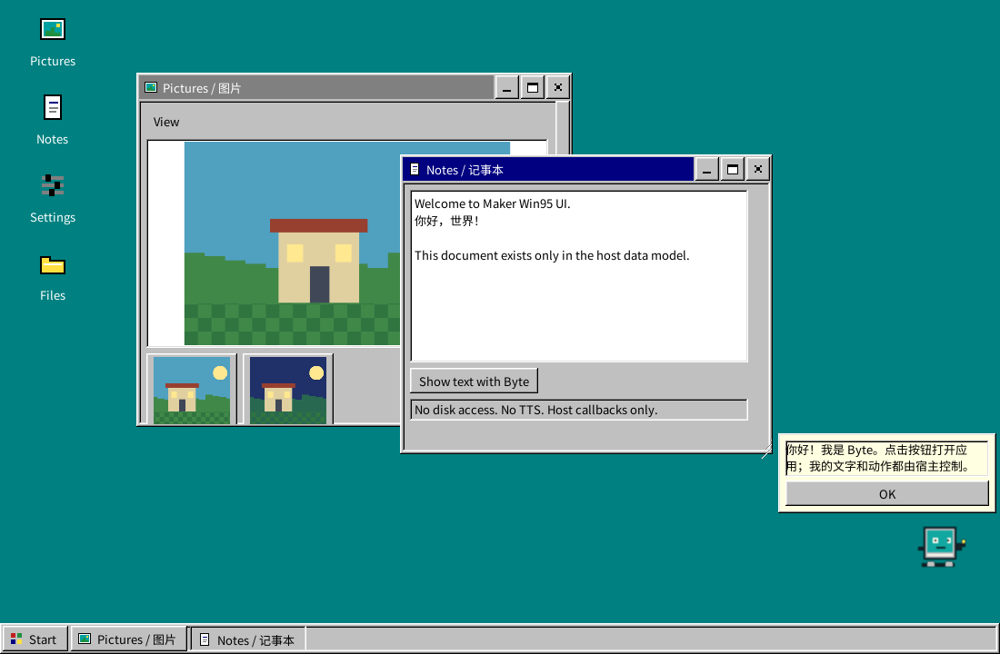

# Maker Win95 UI

Native Windows 95 style components for **TapTap Maker / UrhoX Lua 5.4**. Yoga layout, NanoVG rendering, engine input and virtual lists. No React, DOM, WebView, Node or npm at runtime.

**v1.0.0** — independent library, examples, original icons and animated assistant. MIT code/art; OFL font. [Component matrix](docs/components.md) · [API](docs/api.md) · [Host contracts](docs/contracts.md) · [Validation and reproduction](docs/validation.md) · [Research](docs/research.md) · [Licenses](THIRD_PARTY.md).



## Install in a Maker project

1. Download the versioned ZIP from [Releases](https://github.com/CS-LX/maker-win95-ui/releases/tag/v1.0.0), or check out tag `v1.0.0`. Pin the release commit when integrating.
2. Copy `scripts/win95` into your project's `scripts/win95`, and `assets/win95` into `assets/win95`. Keep `LICENSE`, `THIRD_PARTY.md`, and the font's `OFL.txt` with your distribution. No generated files or hidden configuration are required.
3. The host initializes `urhox-libs/UI` once and supplies an existing container to `Win95.new`. Register a Chinese-capable font before creating widgets. The bundled font is optional if the host supplies its own.
4. UrhoX's resource roots already include `scripts/` and `assets/`. Use `win95/images/garden.png`, **without** an `assets/` prefix.

```lua
local UI = require("urhox-libs/UI")
local Win95 = require("win95")
local kit

function Start()
    UI.Init {
        scale = UI.Scale.DEFAULT,
        fonts = {{family="sans", weights={
            normal="win95/fonts/MakerClassicSans.ttf",
            bold="win95/fonts/MakerClassicSans.ttf",
        }}},
    }
    local root = UI.Panel {width="100%", height="100%", borderRadius=0}
    UI.SetRoot(root) -- host responsibility; the library never calls SetRoot
    kit = Win95.new(root, {density="compact"}) -- or "touch"
    UI.Layout()
    local window = kit:Window {title="Hello / 你好", width=360, height=240}
    window.content:AddChild(kit:Button {
        text="Open a dialog",
        onClick=function()
            kit:MessageBox {message="Hello from native Lua!", cancel=false}
        end,
    })
end

function Stop()
    if kit then kit:Destroy(); kit=nil end
    UI.Shutdown() -- only if this host owns the global UI lifecycle
end
```

The library never loads a scene, moves a camera, reads the real disk, creates an audio listener, replaces the UI root, or changes the global UI theme. Optional desktop/taskbar/assistant modules are constructed only on request.

## Run the three examples

The independent repository is intentionally **not bound to a Maker cloud project**. An already installed Maker UrhoX runtime can execute the examples locally:

```powershell
$env:URHOX_RUNTIME = 'C:\path\to\installed\UrhoXRuntime.exe'
python tools/check.py preview --example gallery --timeout 3600
python tools/check.py preview --example desktop --timeout 3600
python tools/check.py preview --example minimal --timeout 3600
```

Close one preview before starting another. Python is a development launcher only. The launcher adds the package's resource roots and starts the installed native executable; it downloads nothing and changes no Maker binding. `--timeout` ends that launched process after the chosen duration.

For a separate, already bound Maker sample project: copy `examples/Host.lua` to `scripts/Host.lua` and the chosen example to `scripts/main.lua`; use entry `scripts/main.lua` and scriptsPath `scripts`. Follow that project's normal Maker local-preview workflow. **Do not bind or submit this library to a game merely to test it.**

| Entry | Working interactions |
|---|---|
| `examples/gallery.lua` | Six tabs, form editing, 10,000 rows, sorting/tree, icons, image selection, assistants, menus/dialogs/tweens |
| `examples/desktop.lua` | Host-registered Pictures/Notes/Settings/Files, linked windows/taskbar/start menu, editable Chinese notes, Byte actions |
| `examples/minimal.lua` | Public API only: image viewer, settings, callbacks and window tween, no desktop dependency |

## Verification status

Native Windows runtime checks cover state, engine-dispatched mouse/touch/keys, Chinese committed text, virtualization, modal focus, cancellation, ownership and lifecycle. Desktop, portrait/landscape **window sizes**, and 1×/2× UI scale are exercised. These are not phone-device or high-DPI-hardware certification.

**Not verified:** Android/iOS devices, mobile soft keyboards, real IME composition/candidate placement, Web export, screen readers and actual OS DPR > 1. [Exact environment, commands, results and manual steps](docs/validation.md) distinguish these from passing checks. The installed runtime emits two documented startup resource warnings independently of the library.

```powershell
python tools/check.py syntax
python tools/check.py test
python tools/check.py capture --example gallery --tab forms --width 390 --height 844 --density touch
python tools/check.py package
```

No game code or assets are included. Upstream React95 code/design was studied; the Lua implementation and default art were authored for this project. Microsoft Clippy/Windows artwork is excluded. Read [THIRD_PARTY.md](THIRD_PARTY.md) before adding your own character or icon pack.
