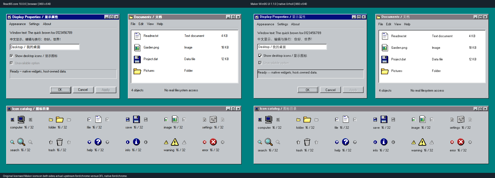

# React95 visual alignment — v1.1.0

This release corrects the previous implementation's visual simplifications. It uses the **React95/React95 core 10.0.6** Win95 theme as its chrome reference (source `97bd045e3133ac1f3c239e3caece74910a7b1291`, matching npm's gitHead). It does not mix that theme with react95-io's alternative palette.

| Detail | v1.0.0 problem | v1.1.0 implementation |
|---|---|---|
| Latin typography | Modern Noto used for all text; bold aliased to regular | OFL W95font regular and actual bold, optically sized at 13 native units against reference CSS 12px |
| Chinese | Regular-only fallback | Real Noto Sans SC 400/700 fallback; Unicode editing and wrapping retained |
| Icons | Small set of simplified geometric silhouettes scaled up | 29 original pixel designs, 58 separate 16/32 rasters; perspective, outlines, highlights and shaded details; per-name lazy Lua scanline data |
| Material / active title | Generic `#c0c0c0` / `#000080` | Reference `#c3c7cb` / `#000e7a`; shadow `#868a8e`, inactive title `#7f787f` |
| Title geometry | 26-unit strip and large square actions | 20-unit compact strip, 17×14 actions, continuous title background behind controls, bold white titles, precise close/min/max/restore glyphs |
| Window / input edges | Generic bevel applied everywhere | Separate frame and inset-input edge order, square corners, dotted keyboard focus; resize diagonals contained inside the frame |
| Scrollbars | Plain track/thumb | Arrow steps, checker track and beveled thumb with matching drag calculations |
| Touch | Must remain usable after shrinking compact controls | Separate 44-unit title/actions/rows/controls and 15-unit font; pan scrolling and single-tap routes retained |

The inactive title keeps white text because the pinned React95 title's CSS text-shadow makes its rendered text white even when its inactive text token is gray. The native window's shadow stays **inside** its widget rectangle; the browser reference casts an additional pixel outside. This avoids clipping or drawing into a sibling's region. The OFL font is a licensed revival with different metrics, not the Microsoft conversion in the upstream package. Chinese fallback and native antialiasing also prevent whole-image pixel equality.

## Same-content, same-size comparison



Left: actual React95 components rendered by Edge, core 10.0.6. Right: actual installed native UrhoX runtime, library 1.1.0. Each source image is **960×640**, scale/DPR 1, pasted without resizing or retouching. Both use the same strings, three window rectangles, form state, focused OK button, data rows, and icon catalog. The published comparison deliberately uses this project's licensed icons on **both** sides to isolate font/chrome differences. The native fixture uses real public component APIs; it is not a rendered web overlay or substitute for interactive tests.

We also rendered the same reference with actual `@react95/icons` 2.8.0 and inspected it beside the native original replacements. That **local-only** figure is generated under `.tmp/comparison/upstream-vs-maker.png`; it is excluded from Git and the public ZIP because it contains upstream Microsoft artwork. Symbol meanings are matched, not silhouettes traced: e.g. the replacement image icon is a framed landscape, settings is a shaded control panel, and the recycle icon is an original ribbed bin. When an upstream icon offers only one of the requested sizes, the browser scales its available raster; Maker supplies dedicated 16/32 artwork. Exact mappings are readable in the fixture source.

Five actual framebuffer sample locations verify matching desktop, panel, active/inactive title and white interior colors. Browser DOM bounds are asserted for all three windows; native tests verify title/button geometry and operations. These are targeted checks, **not a claim of a 100% image match**. The [machine-readable record](visual-results.json) includes source hashes, browser version and coordinates. The eight other [native captures](validation.md#screenshot-review) verify the gallery, desktop, live texture, narrow menus, touch sizes and scale 2.

## Reproduce the comparison

First run the native suite in [validation](validation.md). Use an independent checkout, an installed UrhoX runtime, Python/Pillow, Node, Edge and Playwright for the development comparison only. No browser, npm package or downloaded font is needed by a running Maker game.

```powershell
python tools/check.py capture --example visual --width 960 --height 640
New-Item -ItemType Directory -Force .tmp/reference | Out-Null
Copy-Item tools/reference/package.json,tools/reference/package-lock.json .tmp/reference
Push-Location .tmp/reference
npm ci --ignore-scripts --no-audit --no-fund
Pop-Location
# Use an already installed Playwright package; alternatively install it as a dev tool.
$env:PLAYWRIGHT_PACKAGE='C:/path/to/node_modules/playwright'
node tools/reference/capture.cjs
python tools/compare.py
# Actual upstream icons: local study only; do not copy these outputs into the release.
node tools/reference/capture.cjs --upstream-icons
python tools/compare.py --upstream-icons
```

`tools/reference` contains only the authored comparison fixture and dependency manifest/lockfile. Installed dependencies and built reference font bundles remain in `.tmp`. Original icon sources are `tools/icons.py`; run `python tools/icons.py` to regenerate both PNG previews and lazy Lua modules. Runtime icons allocate no texture handles. All font sources, hashes, copyright and redistribution terms are in [THIRD_PARTY](../THIRD_PARTY.md).
